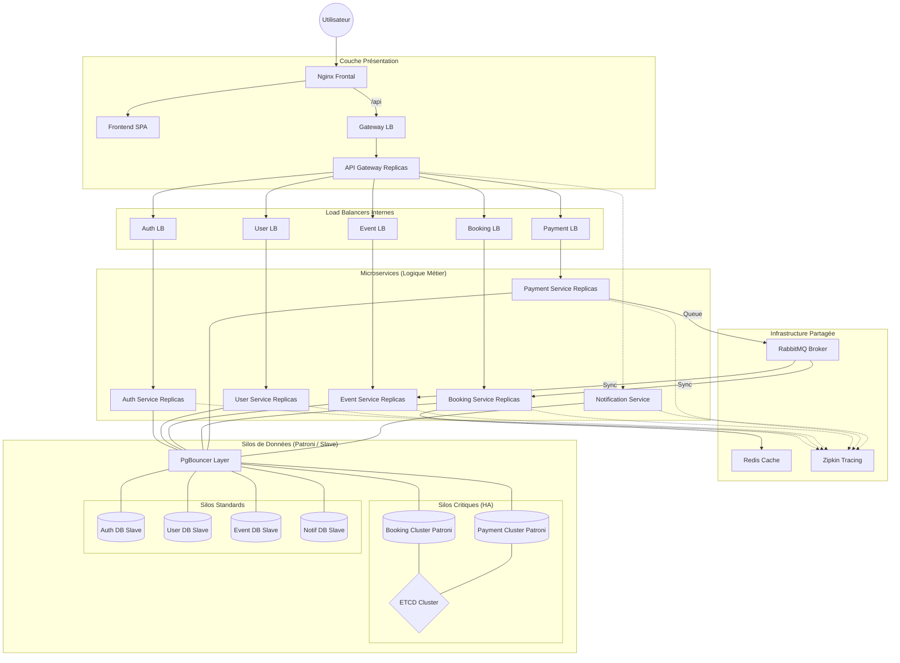

# Architecture — 4WEBD-TICKET

## Flux d'un achat de billet



```

---

## Flux complet d'un achat "Star Tour"

```
  Client
    │
    │ POST /api/bookings  { eventId, quantity, cardToken }
    ▼
  nginx (rate limit 10 req/s)
    │
    ▼
  api-gateway  ──► JWT validation ──► authenticate()
    │
    ▼
  booking-service
    ├─► Redis   → vérifie places disponibles (lock atomique)
    ├─► event-service → confirme l'événement actif
    │
    │  ◄─── répond 202 "Réservation en cours" à l'utilisateur
    │
    ▼
  RabbitMQ  queue: "bookings"
    │
    ├──────────────────────────────────────────────┐
    ▼                                              ▼
  payment-service                      notification-service
    │  consomme RabbitMQ                   │  consomme RabbitMQ
    │  valide la CB (simulé)               │  envoie email/SMS (simulé)
    │  INSERT payment_db                   │  INSERT notif_db
    │  via PgBouncer → payment-db-1        │  via PgBouncer → notif-db
    │
    ▼
  RabbitMQ  queue: "payment.success" / "payment.failed"
    │
    ▼
  notification-service  → notifie l'utilisateur du résultat
```

---

## Tableau des containers (45 total)

| Couche          | Service                   | Image                           | Port interne |
|-----------------|---------------------------|---------------------------------|-------------|
| **Frontal**     | nginx                     | nginx:alpine (custom)           | 80          |
|                 | nginx-replica             | nginx:alpine (custom)           | 80          |
|                 | frontend                  | nginx:alpine (custom SPA)       | 80          |
|                 | frontend-replica          | nginx:alpine (custom SPA)       | 80          |
| **Gateway**     | api-gateway               | node:20-alpine (custom)         | 3000        |
|                 | api-gateway-replica       | node:20-alpine (custom)         | 3000        |
| **Services**    | auth-service              | node:20-alpine (custom)         | 3004        |
|                 | auth-service-replica      | node:20-alpine (custom)         | 3004        |
|                 | user-service              | node:20-alpine (custom)         | 3001        |
|                 | user-service-replica      | node:20-alpine (custom)         | 3001        |
|                 | event-service             | node:20-alpine (custom)         | 3006        |
|                 | event-service-replica     | node:20-alpine (custom)         | 3006        |
|                 | booking-service           | node:20-alpine (custom)         | 3003        |
|                 | booking-service-replica   | node:20-alpine (custom)         | 3003        |
|                 | payment-service           | node:20-alpine (custom)         | 3005        |
|                 | payment-service-replica   | node:20-alpine (custom)         | 3005        |
|                 | notification-service      | node:20-alpine (custom)         | 3002        |
|                 | notification-service-replica | node:20-alpine (custom)      | 3002        |
| **PgBouncer**   | auth-pgbouncer            | bitnamilegacy/pgbouncer         | 6432        |
|                 | user-pgbouncer            | bitnamilegacy/pgbouncer         | 6432        |
|                 | event-pgbouncer           | bitnamilegacy/pgbouncer         | 6432        |
|                 | booking-pgbouncer         | bitnamilegacy/pgbouncer         | 6432        |
|                 | payment-pgbouncer         | bitnamilegacy/pgbouncer         | 6432        |
|                 | notif-pgbouncer           | bitnamilegacy/pgbouncer         | 6432        |
| **DB Standard** | auth-db                   | bitnamilegacy/postgresql:16     | 5432        |
|                 | auth-db-replica           | bitnamilegacy/postgresql:16     | 5432        |
|                 | user-db                   | bitnamilegacy/postgresql:16     | 5432        |
|                 | user-db-replica           | bitnamilegacy/postgresql:16     | 5432        |
|                 | event-db                  | bitnamilegacy/postgresql:16     | 5432        |
|                 | event-db-replica          | bitnamilegacy/postgresql:16     | 5432        |
|                 | notif-db                  | bitnamilegacy/postgresql:16     | 5432        |
|                 | notif-db-replica          | bitnamilegacy/postgresql:16     | 5432        |
| **DB Critique** | booking-db-1 (leader)     | Patroni/postgres:15             | 5432 + 8008 |
|                 | booking-db-2 (replica)    | Patroni/postgres:15             | 5432 + 8008 |
|                 | booking-db-3 (replica)    | Patroni/postgres:15             | 5432 + 8008 |
|                 | payment-db-1 (leader)     | Patroni/postgres:15             | 5432 + 8008 |
|                 | payment-db-2 (replica)    | Patroni/postgres:15             | 5432 + 8008 |
|                 | payment-db-3 (replica)    | Patroni/postgres:15             | 5432 + 8008 |
| **Consensus**   | etcd-1                    | bitnamilegacy/etcd:3.6.4        | 2379 + 2380 |
|                 | etcd-2                    | bitnamilegacy/etcd:3.6.4        | 2379 + 2380 |
|                 | etcd-3                    | bitnamilegacy/etcd:3.6.4        | 2379 + 2380 |
| **Infra**       | rabbitmq                  | rabbitmq:3.11-management        | 5672 + 15672|
|                 | redis                     | redis:7-alpine                  | 6379        |
| **Observ.**     | zipkin                    | openzipkin/zipkin:3             | 9411        |
| **Maintenance** | cron-backup               | node:20-alpine (custom)         | —           |

---

## Points d'accès publics

| URL                          | Service              | Description                    |
|------------------------------|----------------------|--------------------------------|
| `http://localhost`           | nginx → frontend     | Interface utilisateur (SPA)    |
| `http://localhost/api/*`     | nginx → api-gateway  | API REST (JWT requis)          |
| `http://localhost:15672`     | RabbitMQ UI          | guest / guest                  |
| `http://localhost:9411`      | Zipkin UI            | Tracing distribué              |

---

## Choix architecturaux

### Pourquoi PgBouncer ?
Chaque service peut ouvrir jusqu'à 200 connexions clients vers PgBouncer.
PgBouncer maintient un pool de **20 connexions réelles** vers PostgreSQL.
Sans pooler, 200 services × 2 réplicas = 400 connexions directes → crash du CPU PostgreSQL.

### Pourquoi Patroni + ETCD pour booking et payment ?
Ces deux silos sont **critiques** :
- `booking` : perte de données = tickets vendus sans trace
- `payment` : perte de données = transactions financières perdues

Patroni offre un **failover automatique** en < 30 secondes.
ETCD (3 nœuds, quorum = 2) assure le consensus distribué sans split-brain.

### Pourquoi Redis pour le booking ?
Le `booking-service` vérifie et décrémente le compteur de places **en mémoire RAM**.
Latence < 1ms vs. ~5ms PostgreSQL. Garantit qu'on ne vend pas 2 fois le même siège (lock atomique via `DECR`).

### Pourquoi RabbitMQ ?
L'achat est **asynchrone** : l'utilisateur reçoit un `202 Accepted` immédiat.
Le paiement et la notification s'exécutent en arrière-plan.
Si Stripe/Twilio est lent, les messages attendent dans RabbitMQ sans bloquer les ventes.

### Pourquoi des Load Balancers Internes (Nginx proxy) ?
Dans l'architecture `full-infra`, l'API Gateway ne communique plus directement avec les instances `auth-service-replica`. À la place, un container Nginx (`auth-lb`, `user-lb`, etc.) est positionné entre le Gateway et les microservices, utilisant la méthode *Round Robin*. Cela imite la robustesse de Kubernetes (`Services`) et répartit la charge de manière transparente pour le Gateway, qui ignore combien de nœuds sont actifs. L'ensemble des containers utilisent le port commun `3000` via Docker Network, empêchant ainsi tout conflit.

### Pourquoi le `app.set('trust proxy', 1)` ?
Le projet intègre le module `express-rate-limit` pour limiter les attaques DDoS (10 req/s). Lorsque le proxy Nginx frontal ou un Nginx `lb` transmet la requête, il ajoute des entêtes `X-Forwarded-For`. Express refuse cette information si on ne lui spécifie pas explicitement `trust proxy: 1`. Sans cette option, les requêtes entrantes via Nginx retournaient des erreurs `500 Internal Server Error / Validation`.

### Note sur la migration Bitnami (août 2025)
Les images `bitnami/*` ont migré vers `bitnamilegacy/*` (images figées, sans mise à jour)
et `bitnamisecure/*` (payant, mises à jour). Ce projet utilise `bitnamilegacy` pour
rester sur PostgreSQL 16 avec les env vars Bitnami que nous avons configurées.
