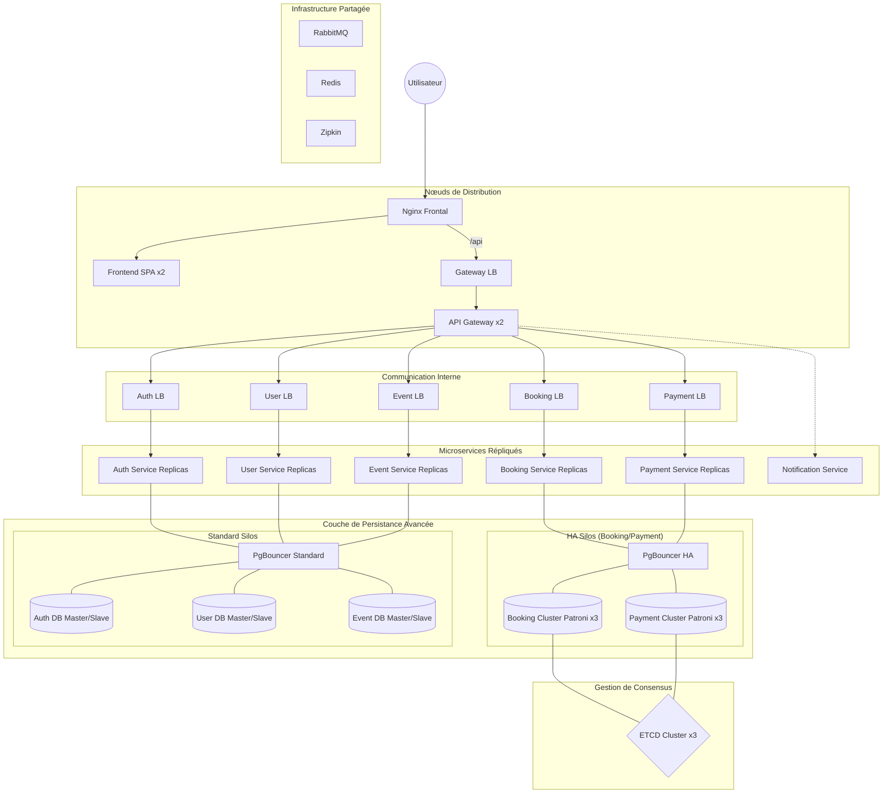

# 4WEBD-TICKET-full-infra — Architecture Haute Disponibilité (HA)

Ce dossier présente une extension avancée du projet TicketApp, conçue pour démontrer la mise en œuvre d'une infrastructure hautement disponible et résiliente, capable de supporter des charges extrêmes.

## Caractéristiques Principales

L'architecture full-infra repose sur 45 conteneurs orchestrés pour offrir une disponibilité maximale. Elle intègre des composants critiques absents de la version standard :

- **Automatic Failover** : Utilisation de **Patroni** et **ETCD** pour garantir une bascule automatique des bases de données de réservation et de paiement en moins de 30 secondes.
- **Orchestration Massive** : Déploiement de **46 conteneurs** assurant la redondance de chaque couche.
- **Gestion Automatisée des Réplicas** : Contrairement à la version `main` qui utilise des scripts `init-replica.sh`, la version `full-infra` s'appuie sur les fonctionnalités natives des images **Bitnami Legacy** pour configurer la réplication Master/Slave et le failover Patroni de manière transparente via des variables d'environnement.
- **Images Bitnami Legacy** : Utilisation volontaire des images `bitnamilegacy` (PostgreSQL, PgBouncer, ETCD). Ces versions "dépréciées" mais stables permettent une configuration HA complète et gratuite, là où les nouvelles versions Bitnami imposent désormais des restrictions ou des coûts de licence.
- **Connection Pooling** : Implémentation de **PgBouncer** pour optimiser les performances et la consommation de ressources CPU des serveurs de base de données.
- **Load Balancing Multi-Niveau** : Redondance des services avec des Load Balancers internes (Nginx) pour une distribution de charge équilibrée.
- **Atomic Locks** : Utilisation de **Redis** pour sécuriser les transactions de billetterie et prévenir toute survente ("Star Tour").

> *Note : Cette architecture est extrêmement "overkill" pour un environnement Docker Compose sur un seul serveur. Elle est conçue pour démontrer une expertise en haute disponibilité (HA) et en résilience réseau.*

## Schéma d'Architecture (Haute Disponibilité)



## Justifications Techniques

### Pourquoi Patroni pour les services critiques ?
Dans cette architecture, nous avons identifié le **Booking** (réservations) et le **Payment** (paiements) comme étant les services les plus critiques. Toute indisponibilité de leur base de données paralyserait le système complet.
- **Patroni** a été choisi pour assurer un **failover automatique**. Si le Master d'un cluster tombe, Patroni (en s'appuyant sur le consensus **ETCD**) élit instantanément un nouveau leader parmi les réplicas.
- Cela garantit une continuité de service sans intervention humaine, contrairement à la version de base où le basculement est manuel.

### Nginx vs HAProxy
Nous utilisons **Nginx** pour l'ensemble des Load Balancers (frontaux et internes). Bien que HAProxy soit extrêmement performant, Nginx offre une plus grande polyvalence (gestion du cache, service de fichiers statiques pour le frontend) et une syntaxe de configuration plus lisible et rapide à mettre en œuvre dans un cadre de démonstration.

### PostgreSQL et Silos Microservices
- **PostgreSQL** : Choisi pour sa solidité et sa conformité ACID, indispensable pour des transactions financières et de billetterie.
- **Silos Microservices** : Chaque service dispose de sa propre infrastructure de donnée. Cette isolation garantit qu'une corruption ou une surcharge sur le service "Notification" n'impactera jamais le service "Payment".
- **Double/Triple DB** : Chaque service dispose d'au moins deux instances de base de données (Master/Slave). Cela permet de déporter les requêtes de lecture (SELECT) sur les réplicas, libérant ainsi le Master pour les opérations d'écriture et augmentant la réactivité globale.

### Haute Disponibilité par Load Balancing
Chaque microservice est protégé par son propre Load Balancer. Cette approche est préférée à une Gateway centralisée unique car elle permet une **résilience granulaire**. Si une instance d'un service rencontre une erreur fatale, le Load Balancer interne redirige le flux vers les instances saines de manière transparente pour l'utilisateur final.

## Pour Aller Plus Loin

Cette version a été développée pour illustrer les mécanismes de résilience requis en production réelle :
- **Observabilité** : Traçage distribué complet via **Zipkin**.
- **Récupération après sinistre** : Failover automatique géré par Patroni en cas de crash d'un leader de base de données.
- **Scalabilité** : Ajout transparent de réplicas applicatifs via les Load Balancers internes Nginx.

## Installation et Lancement

Depuis ce dossier :
```bash
docker-compose up -d --build
```
- Frontend : `http://localhost`
- API Gateway : `http://localhost/api`
- RabbitMQ UI : `http://localhost:15672`
- Zipkin Tracing : `http://localhost:9411`
