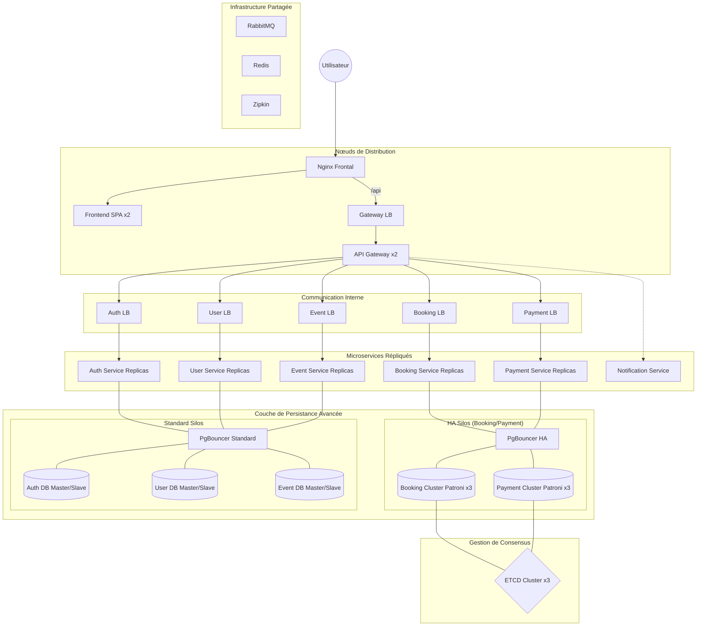

# 4WEBD-TICKET-full-infra — Architecture Haute Disponibilité (HA)

Ce dossier présente une extension avancée du projet TicketApp, conçue pour démontrer la mise en œuvre d'une infrastructure hautement disponible et résiliente, capable de supporter des charges extrêmes.

## Caractéristiques Principales

L'architecture full-infra repose sur 45 conteneurs orchestrés pour offrir une disponibilité maximale. Elle intègre des composants critiques absents de la version standard :

- **Automatic Failover** : Utilisation de **Patroni** et **ETCD** pour garantir une bascule automatique des bases de données de réservation et de paiement en moins de 30 secondes.
- **Orchestration Massive** : Déploiement de **46 conteneurs** assurant la redondance de chaque couche.
- **Connection Pooling** : Implémentation de **PgBouncer** pour optimiser les performances et la consommation de ressources CPU des serveurs de base de données.
- **Load Balancing Multi-Niveau** : Redondance des services avec des Load Balancers internes (Nginx) pour une distribution de charge équilibrée.
- **Atomic Locks** : Utilisation de **Redis** pour sécuriser les transactions de billetterie et prévenir toute survente ("Star Tour").

## Schéma d'Architecture (Haute Disponibilité)



## Pour Aller Plus Loin

Cette version a été développée pour illustrer les mécanismes de résilience requis en production réelle :
- **Observabilité** : Traçage distribué complet via **Zipkin**.
- **Récupération après sinistre** : Failover automatique géré par Patroni en cas de crash d'un leader de base de données.
- **Scalabilité** : Ajout transparent de réplicas applicatifs via les Load Balancers internes Nginx.

## Installation et Lancement

Depuis ce dossier :
```bash
docker-compose up -d --build
```
- Frontend : `http://localhost`
- API Gateway : `http://localhost/api`
- RabbitMQ UI : `http://localhost:15672`
- Zipkin Tracing : `http://localhost:9411`
