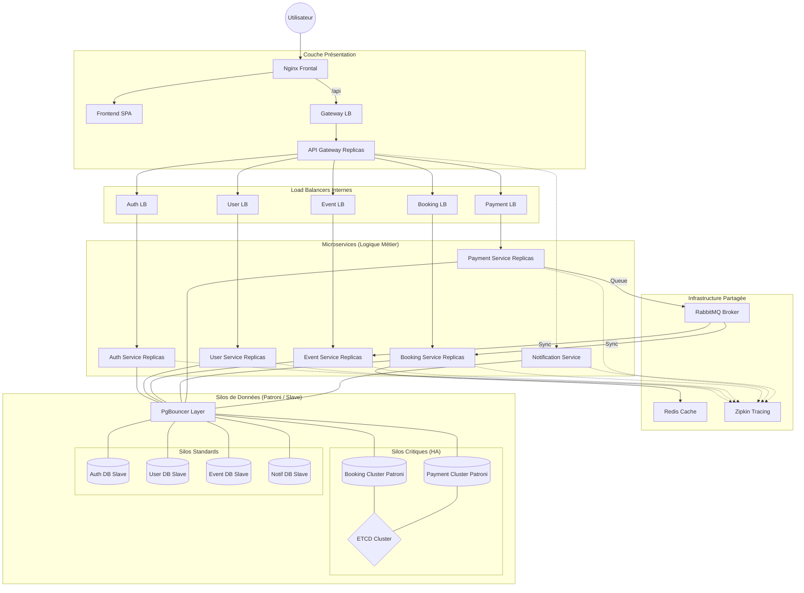

# Architecture — TicketApp

## Vue d'ensemble


## Flow de réservation (queue)

```
  POST /bookings
       │
       ▼
  api-gateway  ──publish──▶  RabbitMQ
                              queue: "bookings"
                                    │
                                    ▼
                            [ booking-service ]
                            • décrémente capacity (atomic UPDATE)
                            • crée le ticket (status: pending)
                            • publish ──▶ queue: "payments"
                                                │
                                                ▼
                                        [ payment-service ]
                                        • simule paiement
                                        ┌──────┴──────┐
                                     succès         échec
                                        │              │
                                  ticket=confirmed  ticket=cancelled
                                  restore capacity (si échec)
                                        │              │
                                        └──────┬───────┘
                                               ▼
                                        queue: "notifications"
                                               │
                                               ▼
                                    [ notification-service ]
                                    • log + sauvegarde en DB
```

## Services

| Service              | Port LB | Instances | Base de données         |
|----------------------|---------|-----------|-------------------------|
| api-gateway          | 3030    | ×2        | —                       |
| auth-service         | 3011    | ×2        | auth-db + auth-replica  |
| user-service         | 3010    | ×2        | user-db + user-replica  |
| event-service        | 3020    | ×2        | event-db + event-replica|
| booking-service      | 3021    | ×2        | booking-db + replica    |
| payment-service      | 3022    | ×1        | payment-db + replica    |
| notification-service | 3023    | ×1        | notif-db + replica      |
| frontend             | 8080    | ×1        | —                       |
| rabbitmq             | 5672    | ×1        | —                       |

## Réplication PostgreSQL (primary / replica)

```
  PRIMARY (écritures)                REPLICA (lectures)
  ┌─────────────────┐                ┌──────────────────┐
  │   INSERT        │  WAL streaming │   SELECT         │
  │   UPDATE   ─────┼───────────────▶│   (read-only)    │
  │   DELETE        │                │                  │
  └─────────────────┘                └──────────────────┘

  Dans le code :
  primaryPool.query(...)   ← INSERT / UPDATE / DELETE
  replicaPool.query(...)   ← SELECT
```

## Structure des dossiers

```
services/
├── auth/
│   ├── auth-service/      ← Express (register, login, JWT)
│   ├── db/                ← init-replica.sh (WAL config)
│   ├── db-replica/        ← Dockerfile + start-replica.sh
│   └── lb/                ← nginx round-robin
├── user/
│   ├── user-service/      ← Express (CRUD users)
│   ├── db/
│   ├── db-replica/
│   └── lb/
├── event/                 ← même structure
├── booking/               ← même structure + consumer RabbitMQ
├── payment/               ← consumer RabbitMQ (simulation paiement)
├── notification/          ← consumer RabbitMQ (log + DB)
├── gateway/
│   ├── api-gateway/       ← Express (routing + publish queue)
│   └── lb/
└── frontend/
    └── frontend-app/      ← HTML + CSS + JS (nginx)
```
