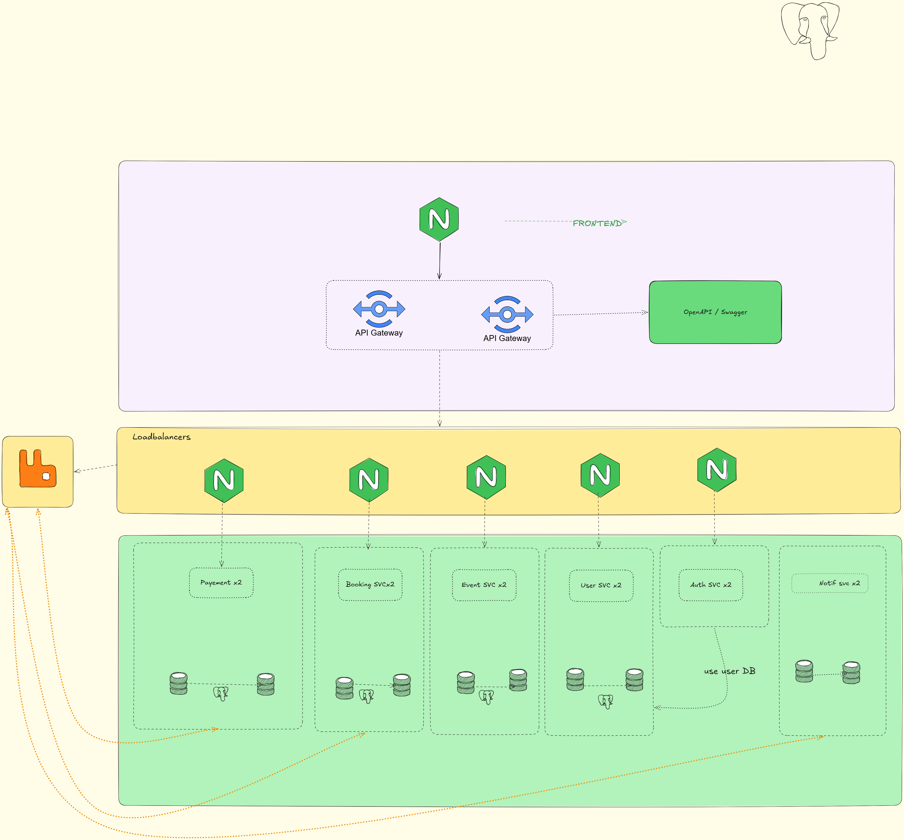

# 4WEBD-TICKET-main — Architecture Microservices Standard

Ce dossier constitue le projet de référence pour l'évaluation. Il implémente une architecture microservices robuste, modulaire et scalable, répondant à l'intégralité des exigences du sujet 4WEBD.

## Alignement avec le Sujet

Ce projet répond spécifiquement aux besoins énoncés :
- **Gestion des Événements** : API CRUD complète via `event-service`.
- **Gestion des Utilisateurs** : API CRUD complète via `user-service`.
- **Authentification et Autorisation** : Gestion sécurisée via `auth-service` (JWT).
- **Processus d'Achat** : Gestion transactionnelle via `booking-service` et validation de paiement via `payment-service`.
- **Notifications** : Système asynchrone via `notification-service` (simulation Email/SMS).
- **Haute Disponibilité** : Tous les services critiques sont répliqués et protégés par des **Load Balancers internes (Nginx)**, assurant une distribution de charge efficace.
- **Déploiement** : Orchestration de **30 conteneurs** Docker.
- **Contexte** : Bien que cette architecture soit "overkill" pour un déploiement sur une seule machine, elle démontre une conception prête pour le passage à l'échelle (scale-out).

## Architecture Technique

Le système est découpé en services autonomes communiquant via REST (synchrone) et RabbitMQ (asynchrone).




### Points Clés
- **Réplication de Données** : Chaque service possède sa propre base de données PostgreSQL configurée avec un Master (écriture) et un Replica (lecture via WAL streaming).
- **Asynchronisme** : L'achat d'un billet déclenche un message dans RabbitMQ, permettant au système de notifier l'utilisateur sans bloquer le flux principal.
- **Performance** : Utilisation de la réplication en lecture (Replica) pour décharger le Master des requêtes SELECT et améliorer la réactivité globale.

## Justifications Techniques

### Pourquoi Nginx ?
Nous avons choisi **Nginx** comme Load Balancer interne pour sa stabilité et sa simplicité de configuration par rapport à des solutions comme HAProxy. Nginx permet une gestion native du Round Robin et s'intègre parfaitement dans un environnement conteneurisé.

**Exemple de configuration (booking-lb) :**
```nginx
upstream booking_backend {
    server booking-service-1:3000;
    server booking-service-2:3000;
}
server {
    listen 3021;
    location / {
        proxy_pass http://booking_backend;
    }
}
```
*Fonctionnement :* Lorsqu'une requête arrive sur le port 3021, Nginx la redirige alternativement vers l'une des deux instances du service de réservation, assurant ainsi une distribution équilibrée de la charge.

### Pourquoi PostgreSQL ?
**PostgreSQL** a été retenu pour sa robustesse et sa fiabilité dans la gestion de données transactionnelles critiques. Sa capacité à gérer des réplications complexes (WAL) garantit la persistance et l'intégrité des données de billetterie.

### Décomposition en Microservices et Silos
Le projet est décomposé en services autonomes (Auth, User, Event, etc.) pour permettre un développement et une scalabilité indépendants. 
- **Silos de données** : Conformément aux bonnes pratiques microservices, chaque service possède son propre "silo" de données (une base de données dédiée). Cela évite le couplage fort entre les services.
- **Double Base de Données (Master/Replica)** : Chaque silo est doublé. Le Master gère les écritures pour garantir la cohérence, tandis que le Replica gère les lectures, augmentant ainsi la disponibilité et les performances globales.

### Pourquoi Load Balancer pour tous les services ?
L'API Gateway seule ne suffit pas à garantir la haute disponibilité. Si une instance d'un service tombe, le Load Balancer interne détecte l'échec et redirige le trafic vers les instances saines. Sans cette couche intermédiaire, la Gateway tenterait d'envoyer des requêtes vers des services indisponibles, provoquant des erreurs en cascade.

## Installation et Lancement

### Prérequis

Depuis le dossier `4WEBD-TICKET-main` :

```bash
cd 4WEBD-TICKET-main

# Copier le fichier d'environnement
cp .env.example .env

# Rendre les scripts de replica exécutables
chmod +x services/booking/db/init-replica.sh \
         services/notification/db/init-replica.sh \
         services/payment/db/init-replica.sh \
         services/user/db/init-replica.sh \
         services/event/db/init-replica.sh
```

### Lancement

```bash
docker compose up -d --build
```
- Frontend : `http://localhost:8080`
- API Gateway : `http://localhost:3030/api`
- RabbitMQ UI : `http://localhost:15672`

### Données de Test

Pour remplir la base de données avec des données fictives (utilisateurs et événements), vous pouvez utiliser le script de seeding :

```bash
# Accorder les droits d'exécution
chmod +x scripts/seed-data.sh

# Exécuter le script
./scripts/seed-data.sh
```

Ce script crée les 3 utilisateurs suivants :

| Rôle | Email | Mot de passe |
|------|-------|--------------|
| **Admin** | admin@admin.com | admin1234 |
| **Organisateur** | operator@operator.com | operator1234 |
| **Utilisateur** | user@user.com | user1234 |
