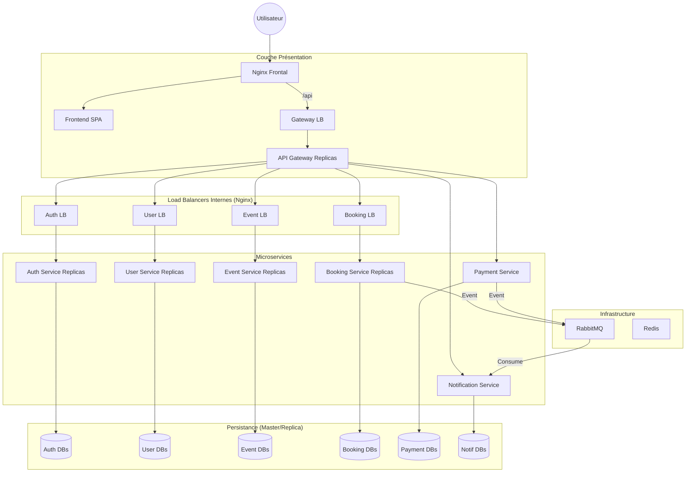

# 4WEBD-TICKET-main — Architecture Microservices Standard

Ce dossier constitue le projet de référence pour l'évaluation. Il implémente une architecture microservices robuste, modulaire et scalable, répondant à l'intégralité des exigences du sujet 4WEBD.

## Alignement avec le Sujet

Ce projet répond spécifiquement aux besoins énoncés :
- **Gestion des Événements** : API CRUD complète via `event-service`.
- **Gestion des Utilisateurs** : API CRUD complète via `user-service`.
- **Authentification et Autorisation** : Gestion sécurisée via `auth-service` (JWT).
- **Processus d'Achat** : Gestion transactionnelle via `booking-service` et validation de paiement via `payment-service`.
- **Notifications** : Système asynchrone via `notification-service` (simulation Email/SMS).
- **Haute Disponibilité** : Tous les services critiques sont répliqués et protégés par des Load Balancers.
- **Déploiement** : Orchestration de **30 conteneurs** Docker.

## Architecture Technique

Le système est découpé en services autonomes communiquant via REST (synchrone) et RabbitMQ (asynchrone).



### Points Clés
- **Réplication de Données** : Chaque service possède sa propre base de données PostgreSQL configurée avec un Master (écriture) et un Replica (lecture via WAL streaming).
- **Asynchronisme** : L'achat d'un billet déclenche un message dans RabbitMQ, permettant au système de notifier l'utilisateur sans bloquer le flux principal.
- **Performance** : Utilisation de Redis pour optimiser la gestion des places disponibles et éviter la survente lors de fortes charges.

## Installation et Lancement

Depuis ce dossier :
```bash
docker-compose up -d --build
```
- Frontend : `http://localhost:8080`
- API Gateway : `http://localhost:3030/api`
- RabbitMQ UI : `http://localhost:15672`
